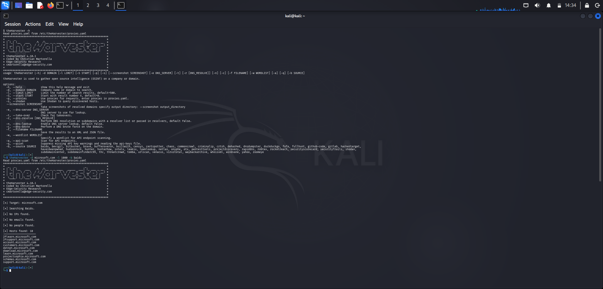
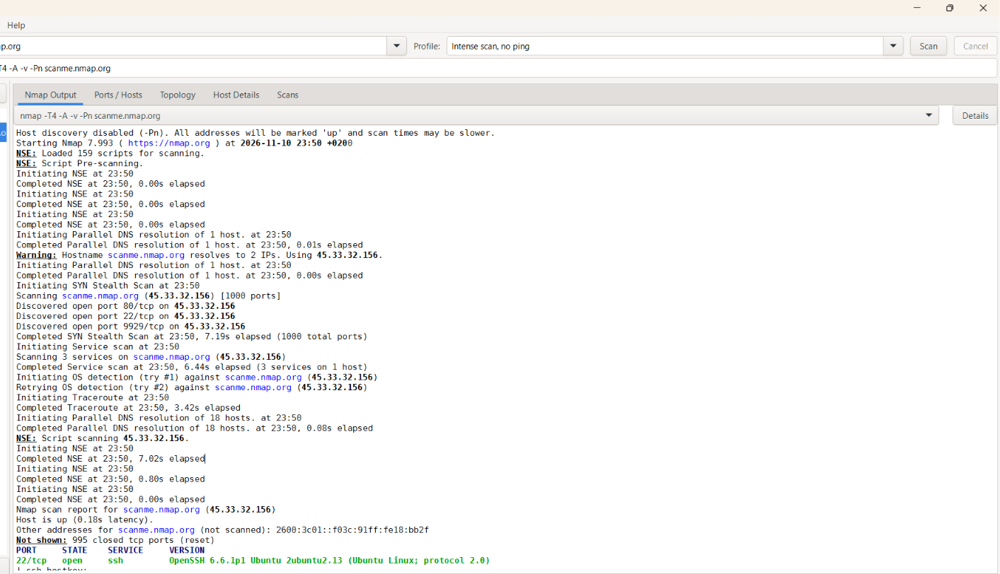

# 🛡️ Penetration Testing Report: Footprinting & Network Scanning


**W2-PM-FINAL | Cybersecurity | Networkwalks**

This repository documents my Week 2 project work from the Cybersecurity & Ethical Hacking internship with **NetworkWalks**. It covers the first two phases of a penetration test, **Reconnaissance & Footprinting** and **Scanning**, with the exact commands I ran, the results I got, and how I read each output.

📄 **Full formal report:** [W2-PM-FINAL Report .pdf](W2-PM-FINAL%20Report%20.pdf)

---

## 📋 Report Overview

| Field | Detail |
|---|---|
| **Pentester** | Furat Omer |
| **Program / Batch** | B084 - Networkwalks |
| **Date** | 11 Nov 2026 |
| **Modules completed** | W2-PM1 (Multiple Kali Tools), W2-PM4 (theHarvester), W2-PM5 (Zenmap Scanning) |
| **Permission secured?** | Yes, written authorization for networkwalks.com and my own LAN |
| **Phases covered** | Phase 1: Reconnaissance & Footprinting, Phase 2: Scanning |

### Scope of each activity

| Activity | Target | Authorization basis |
|---|---|---|
| WHOIS, WhatWeb, Nslookup, Curl, Wafw00f, DNSRecon | `networkwalks.com` | Written permission from Network Walks |
| Zenmap Ping Scan | My own local network | I own and control it |
| Zenmap Intense Scan | `scanme.nmap.org` | Public test host that the Nmap project provides for practicing scans |
| theHarvester | `microsoft.com` | Passive OSINT on public data sources only, used as the practice target from the training module. No scanning of the target's systems. |

> ⚠️ **Disclaimer:** All active testing was done only on systems where I had permission or that I own. This material is for educational purposes only. Unauthorized access is a crime in most countries.

---

## 🗺️ The 5 Phases of a Penetration Test

| # | Phase | Status |
|---|---|---|
| 1 | Reconnaissance & Footprinting | ✅ Covered in this report |
| 2 | Scanning & Enumeration | ✅ Covered in this report |
| 3 | Gaining Access | ⏳ Upcoming |
| 4 | Maintaining Access | ⏳ Upcoming |
| 5 | Covering Tracks & Reporting | 📝 Reporting practiced here (this report) |

---

## 🧰 Tools Used

| Tool | Purpose |
|---|---|
| WHOIS | Domain registration details |
| WhatWeb | Fingerprint web technologies |
| Nslookup | Resolve a domain to its IP |
| Curl | Read HTTP response headers |
| Wafw00f | Detect a Web Application Firewall |
| DNSRecon | Enumerate DNS records |
| theHarvester | OSINT: emails, hosts, and IPs from public sources |
| Zenmap (Nmap GUI) | Host discovery and port scanning |

---

# 🔍 Phase 1: Footprinting & Reconnaissance

Target: **networkwalks.com**

## 1. WHOIS: domain registration

```bash
whois networkwalks.com
```


**Results**
- Registrar: GoDaddy.com, LLC
- Created: 2019-11-06, expires: 2027-11-06
- Registrant details are hidden behind a privacy service (Domains By Proxy)
- Name servers: `NS6135.HOSTGATOR.COM`, `NS6136.HOSTGATOR.COM`
- Transfer, update, delete, and renew locks are enabled
- `DNSSEC: unsigned`

**How I read it:** WHOIS shows who registered the domain and where its DNS is hosted. Privacy protection and registrar locks are good practice. Unsigned DNSSEC means DNS answers are not cryptographically signed.

---

## 2. WhatWeb: web technology fingerprinting

```bash
whatweb networkwalks.com
```


**Results**
- `http://` returns `301 Moved Permanently` and redirects to `https://`
- Web server: Apache
- CMS: WordPress 7.1.4, plugin: WordPress Download Manager 3.3.76
- JavaScript: jQuery 3.7.1, Google Tag Manager
- Server IP: `192.232.216.135`
- A contact email is exposed in the page: `info@networkwalks.com`
- Cookie `__wpdm_client` is set with the `HttpOnly` flag

**How I read it:** The status code `301` shows the site forces HTTPS. The bracketed fields reveal the technology stack, which tells an attacker which software versions to research.

---

## 3. Nslookup: DNS resolution

```bash
nslookup networkwalks.com
```


**Results**
- `networkwalks.com` resolves to `192.232.216.135`
- The answer is marked **Non-authoritative**, meaning it came from my local resolver's cache, not from the domain's own name server

---

## 4. Curl: HTTP response headers

```bash
curl -I https://networkwalks.com
```


**Results**
- `HTTP/2 200` and `server: Apache`
- `link:` header exposes the WordPress REST API endpoint `/wp-json/`
- Hosting cache headers are visible (`x-nginx-cache`, `x-endurance-cache-level`)
- Cookie is set with `secure; HttpOnly`
- `referrer-policy` and `permissions-policy` are present
- Not seen in the response: `Strict-Transport-Security`, `Content-Security-Policy`, `X-Frame-Options`, `X-Content-Type-Options`

**How I read it:** Headers show what the server reveals about itself and which browser protections are enabled. Missing security headers are hardening opportunities, not confirmed vulnerabilities.

---

## 5. Wafw00f: WAF detection

```bash
wafw00f networkwalks.com
```


**Result:** The site is behind **ModSecurity (SpiderLabs)** WAF.

---

## 6. DNSRecon: DNS enumeration

```bash
dnsrecon -d networkwalks.com
```


**Results**

| Record | Finding |
|---|---|
| SOA / NS | `ns6135.hostgator.com`, `ns6136.hostgator.com` |
| A | `networkwalks.com` → `192.232.216.135` |
| MX | `mail.networkwalks.com` → `192.232.216.135` (same server as the website) |
| TXT (SPF) | `v=spf1 +a +mx +ip4:... +include:websitewelcome.com ~all` |
| SRV | 8 `_autodiscover._tcp` records pointing to cPanel email discovery |
| DNSSEC | No answer to the DNSSEC query |
| Name server software | BIND version `9.16.23-RH` is disclosed by both name servers |

**How I read it:** Each record type tells a different story: NS shows who hosts DNS, MX shows the mail server, TXT shows email policy. The SPF record ends with `~all` (soft fail), which is more permissive than `-all`.

---

## 7. theHarvester: OSINT

theHarvester collects emails, subdomains, and IPs from public sources like search engines and certificate logs.

**Run 1: single source (Baidu)**

```bash
theHarvester -d microsoft.com -l 1000 -b baidu
```



Result: 10 hosts, no IPs, no emails.

**Run 2: all sources**

```bash
theHarvester -d microsoft.com -l 50 -b all
```


Result: **47 IPs, 3 emails, 9,962 hosts**.

**How I read it:** The source you choose (`-b`) changes the output a lot. A single search engine gave 10 hosts, while querying all sources gave thousands. This shows how much information about an organization is already public before any active scanning starts.

---

# 📡 Phase 2: Scanning with Zenmap

## 1. Host discovery on my local network

Steps:
1. Found my IP address and subnet with `ipconfig` in Windows CMD.
2. Entered the subnet in Zenmap and selected the **Ping Scan** profile (equivalent to `nmap -sn <subnet>`).
3. Collected the live hosts with their IP and MAC addresses.
4. Opened the **Topology** tab, enabled the legend, and saved the network map as a PDF.


> IP and MAC addresses in the screenshots are redacted for privacy.

## 2. Port and service scan on scanme.nmap.org

`scanme.nmap.org` is a host the Nmap project provides for people to practice scanning.

```bash
nmap -T4 -A -v -Pn scanme.nmap.org
```



| Flag | Meaning |
|---|---|
| `-T4` | Faster timing template |
| `-A` | Aggressive mode: OS detection, version detection, scripts, traceroute |
| `-v` | Verbose output |
| `-Pn` | Skip host discovery, treat the host as up |

**Results**
- SYN stealth scan of 1,000 ports
- Open ports: `22/tcp` (SSH, OpenSSH 6.6.1p1 Ubuntu), `80/tcp` (HTTP), `9929/tcp`
- 995 ports closed (the host replied with TCP reset)

**How I read it:** Open ports are the attack surface. The version of each service (such as the OpenSSH version) is what a tester would research for known weaknesses. Closed ports reply with a reset, while filtered ports give no reply.

---

# ⚖️ Risk Analysis

| # | Finding | Evidence | Potential Impact | Risk |
|---|---|---|---|---|
| 1 | Web technology and version information exposed | WhatWeb: WordPress and Download Manager versions | Helps attackers research known issues for those versions | 🟡 Medium |
| 2 | DNS infrastructure information exposed | DNSRecon: NS, MX, SPF, SRV records | Builds a broader infrastructure profile | 🟡 Medium |
| 3 | DNS server software version disclosed | DNSRecon: BIND `9.16.23-RH` | Reveals software version of the name servers | 🟢 Low |
| 4 | DNSSEC not enabled | WHOIS: `DNSSEC: unsigned` | DNS responses are not cryptographically signed | 🟢 Low |
| 5 | SPF policy uses soft fail | TXT record ends with `~all` | Spoofed mail may be less strictly rejected | 🟢 Low |
| 6 | Server IP and mail on the same host | Nslookup and DNSRecon: web and MX share `192.232.216.135` | Web and mail share one point of exposure | 🟢 Low |
| 7 | HTTP security headers not seen | Curl: no HSTS, CSP, X-Frame-Options, X-Content-Type-Options | Missed browser-side protections | 🟢 Low |
| 8 | REST API endpoint exposed | Curl: `/wp-json/` | Assists enumeration | 🟢 Low |
| 9 | WAF technology identifiable | Wafw00f: ModSecurity | Reveals part of the security architecture | 🟢 Low |
| 10 | Multiple live hosts on the local network | Zenmap Ping Scan | Unknown devices could be present | 🟡 Medium |

**Good practices observed:** HTTP redirects to HTTPS, a WAF is in place, registrant details are privacy-protected, domain registrar locks are enabled, and the site cookie uses `Secure` and `HttpOnly`.

> These are **observations, not confirmed vulnerabilities**. No exploitation or vulnerability validation was performed. A version number or DNS record does not by itself mean a system is vulnerable. Further authorized testing would be required to confirm any real weakness.

---

# ✅ Recommendations

- **Limit exposed technology details:** reduce version information in headers and generator tags where possible.
- **Keep software updated:** update WordPress core and plugins and check them against current security advisories.
- **Add security headers:** consider HSTS, CSP, X-Frame-Options, and X-Content-Type-Options.
- **Review DNS configuration:** hide the BIND version, consider enabling DNSSEC, and consider tightening SPF to `-all` after testing.
- **Keep the WAF enabled and tuned:** ModSecurity should stay active and updated.
- **Scan your own network regularly:** investigate any unknown device that appears.
- **Document the network:** keep topology and device inventory current.
- **Test only with authorization:** reconnaissance and scanning must stay within an authorized scope.

---

# 💡 What I Learned

- **Reading tool output matters as much as running the tool.** Status codes, DNS record types, header names, and port states each tell a specific story.
- **Footprinting is mostly passive.** A lot can be learned about an organization from public data before sending a single scan packet.
- **Scanning shows the attack surface.** Open ports and service versions guide what to test next.
- **A finding is not a vulnerability.** A good report separates observations from confirmed issues and explains impact and remediation.
- **Authorization and scope come first.** Every active test needs written permission and a defined scope.

---

# 📁 Repository Contents

```
.
├── README.md
├── W2-PM-FINAL Report .pdf
└── screenshots/
```

---

## 👤 Author

**Furat Omer**
Cybersecurity Intern @ Network Walks (Batch B084)

[](https://github.com/FuratOmer)
[](https://www.linkedin.com/in/furat-omer-a195572b4)

---
